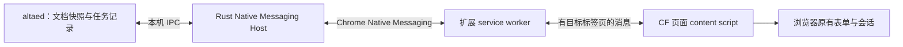

# Codeforces 提交研究与首轮实现方案

研究日期：2026-11-03。本文区分已核实资料、当前代码能力与工程提案；不是提交功能已完成的声明。只在本地记录研究，没有安装浏览器扩展、读取账号 Cookie、登录、上传源码、真实提交或触发云端构建。

## 结论与选型

优先实现 Chrome Manifest V3 扩展加本地 Rust 桥接，借用用户在所选浏览器配置中的 CF 会话。IDE 负责文档快照、任务状态和展示；扩展负责当前 CF 页面交互，登录及站点验证由用户在浏览器完成。暂不为第一条真实链路内嵌 Chromium，也不引入 rmj.ac 的账号服务、数据库或 Graph。

CF 官方方法列表有提交记录查询，没有公开的代码提交方法；不能用 API 查询成功代替提交成功。[CF 方法列表](https://codeforces.com/apiHelp/methods?locale=en)

直接接管日常 Chrome 的调试端口也不作为默认路线：Chrome 136 起，远程调试开关要求非默认数据目录，无法假定自动复用日常浏览器会话。[Chrome 官方说明](https://developer.chrome.com/blog/remote-debugging-port)

这些是基于资料和现有代码的选型判断。登录后的 CF 表单结构、语言列表、提交响应和可靠提交编号关联，仍需要后续真实链路验证。

## 当前代码与参考实现

| 已有部分 | 可以复用的能力 | 尚缺部分 |
| --- | --- | --- |
| `altaed-core::document` / `problem` | DocumentId、独立题目实例、原始样例与可编辑测试、运行配置 | 平台专用的结构化提交目标 |
| `altaed-core::runner` | 不可变文档快照、每次独立执行标识与目录 | 远程提交任务、未知结果恢复 |
| `altaed-core::storage` / `atomic_file` | 版本化持久化、原子单文件写入与错误上下文 | 独立的提交记录格式与恢复策略 |
| 原生题目面板 | 已展示标题、URL、分组、题目限制与输入输出方式 | 题目绑定编辑、提交状态与远程语言选择 |
| 配置注册机制 | 平台设置与文档附属项可扩展 | 可实际执行的外部提交插件协议 |

Competitive Companion 接收服务现已实现，见[题目模型与导入](problem-import.md)。浏览器导入的来源 URL 可供后续平台适配器解析，但不会直接触发提交。配置注册测试里的 `plugin.submit` 仍只是扩展示例，不是提交插件。

已读 rmj.ac 的 CF provider、浏览器提交和状态追踪实现。借鉴其“平台参数→提交上下文→本地记录→远程结果”的职责划分，但需要独立实现以下部分：

- 不复制 `JSESSIONID` 到 IDE 配置或进程消息；使用浏览器自己的会话。
- 不复制旧语言 ID 表；从当前目标页面读取选项。
- 不从返回页面选择第一条 `data-submission-id` 作为本次编号。
- 不把发送后的异常统一报告为确定失败；须保留结果未知状态。
- 不直接复用未公开的 WebSocket 消息数组格式；第一版先使用可核实的页面/API查询路径。

参考源码位于 `rmjac/packages/core/src/service/judge/provider/oj/codeforces.rs` 与 `rmjac/packages/vjudge/vjudge_services/codeforces/{submit,track}.ts`。它们是本地参考，不是本轮已经通过验证的 CF 协议。

## 浏览器桥接边界

拟采用的链路：

Chrome 由扩展调用 `connectNative` 启动 host，IDE 不能假定直接取得该 stdio 通道。必须另外实现 host 与已运行 IDE 之间的 IPC。Native Messaging 使用 UTF-8 JSON 加四字节本机字节序长度前缀；host 发给 Chrome 的单条消息上限为 1 MB。协议必须按序列化后字节数限长，不截断源码。host 的 stdout 只写协议，日志写 stderr。[Chrome Native Messaging](https://developer.chrome.com/docs/extensions/develop/concepts/native-messaging)

提案：macOS 使用仅当前用户可访问的 Unix socket，Windows 使用带用户访问控制的 named pipe；浏览器 host 保持轻量，不能创建 GPUI 窗口或承担提交业务。通道握手包含版本、连接标识和能力，重新连接后重新核实账号与任务状态。

扩展仅申请实际使用的 Native Messaging、存储与 CF 站点权限；第一版不使用 cookies、debugger 或全浏览器代理权限。content script 经 service worker 转发消息，并验证发送页、站点和当前任务；页面数据不能直接变成任意文件、进程或网络命令。[Content scripts](https://developer.chrome.com/docs/extensions/develop/concepts/content-scripts)

安装器以后负责平台对应的 host 注册与固定扩展 ID。研究阶段只生成可审查的安装材料，不自动修改用户浏览器配置。浏览器多 profile、扩展停用、Chrome 关闭、IDE 重启必须有明确连接状态。

## 题目与语言

CF 适配器解析允许的 HTTPS 地址与题目路径，不以 URL 字符串替代 DocumentId。普通题库、比赛、Gym、Group 需要保留其原始作用域；不能只抽取比赛号后统一送到 `/contest/…`。第一轮真实提交先覆盖普通题库与已结束比赛，其他作用域识别后明确显示尚未支持，避免提交到错误页面。

CF 的远程语言选择应包含平台返回的 ID、完整显示名称、来源页面和获取时间，并在发送前确认仍可用。本地 `CppStandard` 只控制本机编译与 clangd；不直接映射成某个固定 CF 语言 ID。可以提示候选语言，由用户确认；不能把本地 g++ 的版本当成 CF 提供的编译器版本。

Companion 导入沿用官方 JSON：标题、URL、限制、输入输出约定、interactive 标记、样例、batch 等转成文档拥有的信息。每次导入创建新实例；同 URL 不覆盖其他文档。它提供的信息不能当作 CF 当前可提交语言列表。[Companion 协议](https://github.com/jmerle/competitive-companion#custom-tools)

## 任务模型与发送边界

`problem` 模块已在 altaed-core 中实现；拟继续增加普通 `submission` 模块。实际浏览器 host 因进程边界再单独建立 binary。没有界面或 Editor 类型进入提交核心。

每个任务至少冻结：

- 有类型的 SubmissionJobId、DocumentId、源码全文与摘要、创建时间。
- 平台、解析后的题目目标、远程语言 ID 与显示名。
- 经页面核实的账号与浏览器连接身份、选中的通道。
- 本地阶段、发送尝试信息、远程编号和编号关联依据。

源码和任务信息先放在同一个带版本的任务记录中，以原子替换更新状态；记录对原始快照的绑定不随编辑器继续输入而改变。提交记录由独立目录保存，按 DocumentId 关联；不能放进同题文档共用的可变记录中。恢复时校验快照摘要和格式版本，错误要可见，不能自动覆盖损坏记录。

初始生命周期建议如下：

| 状态 | 含义与允许动作 |
| --- | --- |
| Prepared | 本地快照已固定，尚未向 CF 发出提交；可以取消 |
| WaitingForUser | 等待登录、站点验证或用户补全语言选择；没有自动继续发送 |
| Ready | 页面、账号、题目、语言和源码均已核对；即将执行一次提交 |
| Sending | 已持久化发送边界，再调用浏览器；此后失败可能无法确定远端是否接收 |
| Unknown | 发送后断线、超时或恢复时无法核实；先查证，禁止自动重发或换通道 |
| Accepted | 获得明确且可关联的 CF submission ID；不是答案已通过 |
| Judging | 评测中，保留当前可见结果 |
| Completed | 已取得本轮评测结果；后续系统测试或重评可更新 |
| RejectedBeforeAcceptance | 站点明确拒绝该请求且能确认没有被接收 |
| CancelledBeforeSend | 在发送边界之前取消 |

“Accepted”是站点接收请求，与 verdict 为 OK 分开。点击停止等待不等于撤回远端提交。已发送任务重启后若缺少确定编号，按 Unknown 恢复，即使实际发送前刚好崩溃也不贸然重发。

## 可靠关联提交编号：首要验证项

本地 request ID 不是 CF 幂等键。同一账号的插件提交先串行执行，但用户仍可能在其他标签页手动提交，串行队列不能解决全部关联问题。

后续协议验证应按以下顺序寻找证据：

1. 观察本次表单提交响应或跳转是否直接提供特定 submission ID，并核对账号、题目与语言。
2. 若只能看到状态列表，记录发送前基线与发送后的候选，尽量核对来源与源码；这些只能辅助查证，不能仅凭“最新”或“唯一新增”自动确认。
3. 仍无法确定时，保持 Unknown，向用户展示候选与远端页面，允许用户明确关联编号。不能把“填表成功”包装成“提交成功”。

本轮未登录 CF。匿名读取普通提交入口被重定向到首页，未取得可验证的提交表单或响应样本，因此上述第一种证据是否可用尚未确定。不能现在承诺已经解决一键提交的编号关联。

CF `Submission` 对象可提供账号/题目上下文、编译语言、评测状态、耗时与内存；这些适合在已有确定编号后核对和更新结果，不是请求幂等机制。[返回对象](https://codeforces.com/apiHelp/objects#Submission)

公开状态可先经 `user.status` / `contest.status` 查询，并只更新已绑定的编号。共享请求调度器遵守官方当前每两秒最多一次 API 请求的限制，退避网络失败，不为每个文档单独高频轮询。私有赛题、Gym、Group 等场景不能假定匿名查询足够，后续保留浏览器通道。[查询方法](https://codeforces.com/apiHelp/methods?locale=en)、[API 限制](https://codeforces.com/apiHelp)

## 外部插件与中继

先围绕 CF 的实际替换边界建立外部进程协议：描述能力、解析目标、读取语言、准备提交、提交、查询/恢复。消息带协议版本和请求标识；插件收到请求不等于 CF 已接收。平台目标在协议边界传输，由对应适配器转为有类型的字段并校验。第二个独立插件验证可复用后，再扩大 SDK 范围。

两类中继仍按已确认的方向分别推进：

- 加密网络中继改变浏览器到 CF 的网络路径，账号会话仍在本机；代理设置与用户已有配置的兼容须单独设计。
- 云端代提交是另一执行通道，需要隔离的云端账号会话、任务幂等和未知结果查证。不能把本机浏览器 Cookie 自动迁移过去，也不能在直连发送超时后自动改用云端再发一次。

第一条本地提交链路不依赖中继服务；研究和本地开发不部署服务、不 push，也不生成 Windows 版本。

## 可以直接开始的细分增量

| 次序 | 可交付内容 | 完成边界 |
| --- | --- | --- |
| 1 | 题目绑定与目标解析；提交快照、状态与持久化 | 无需登录，覆盖文档隔离、另存为和未知状态恢复 |
| 2 | Rust host 与 Chrome 扩展的连接、版本/能力握手 | 真实本机桥接；断线可见；不伪造账号或平台结果 |
| 3 | 登录状态与语言读取、源码和题目预填 | 用户能亲自核对页面；没有真实发送不能标记 Submitted |
| 4 | 一次真实提交与 submission ID 关联 | 用真实账号/题目验证响应，取得编号；外部账号动作需到该阶段具体安排 |
| 5 | 结果更新、重启恢复、重复点击和断线处理 | 只有明确编号才能自动关联结果；未知状态不自动重发 |
| 6 | Companion 导入复用文档模型；第二插件验证 | 重复导入新建，平台信息与每份代码保持隔离 |
| 后续 | 网络中继、云端代提交、发布安装材料 | 各自验证真实链路；用户说发布后才 push/云端构建 |

第一轮不新增大型提交控制台：后续沿用现有运行区和状态展示方式，题目绑定后显示提交入口，软件设置管理连接与账号，文档配置管理目标及远程语言。具体 UI 由单独设计与用户验收决定，本研究没有修改现有界面。
